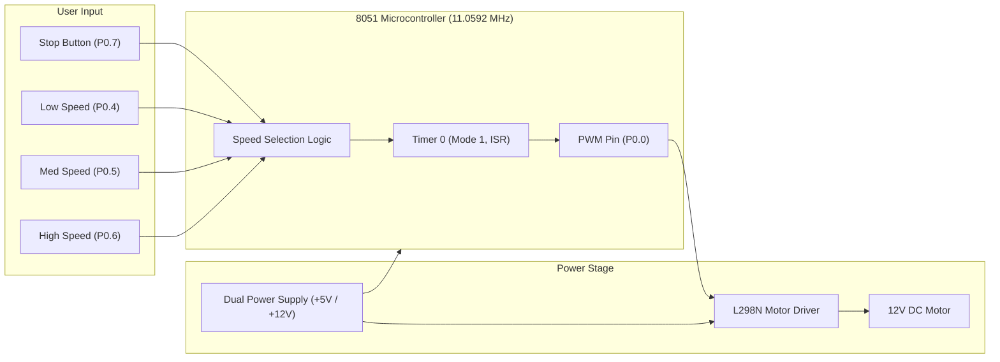

# PWM_DC_motor_Speed_Control_8051

> **PWM-Based DC Motor Speed Control Using 8051 Microcontroller**  
> An embedded firmware and hardware implementation for controlling the rotational speed of a 12V DC motor using **Pulse Width Modulation (PWM)** generated by an **8051 Microcontroller (AT89C51 / AT89S51)** and driven through an **L298N Dual H-Bridge Motor Driver**.

[](https://github.com/VipulKumar-23/PWM_DC_motor_Speed_Control_8051)
[](LICENSE)
[]()
[]()

---

## 📌 Project Overview

Precise speed control of DC motors is fundamental in industrial automation, robotics, conveyor systems, and consumer electronics. This project implements variable duty-cycle PWM generation using **Timer 0 in Mode 1 (16-bit Timer)** with interrupt-driven output toggling.

By switching the effective average voltage supplied to the motor armature, four discrete operational speed profiles are supported:
- **Stop**: 0% Duty Cycle (Motor halted)
- **Low Speed**: ~40% Duty Cycle (PWM Value = 102/255)
- **Medium Speed**: ~60% Duty Cycle (PWM Value = 153/255)
- **High Speed**: 100% Duty Cycle (PWM Value = 255/255)

---

## 🏗️ System Architecture



---

## ⚙️ Technical Specifications & Pin Mapping

### Pin Connection Matrix

| 8051 Pin | Port Line | Interface Target | Function | Active State |
|:---|:---|:---|:---|:---|
| Pin 39 | `P0.0` | L298N `IN1` / `ENA` | PWM Output Signal | HIGH / LOW (Modulated) |
| Pin 35 | `P0.4` | Push Button 1 | Low Speed Select (~40%) | Active-LOW (Pull-Up) |
| Pin 34 | `P0.5` | Push Button 2 | Medium Speed Select (~60%) | Active-LOW (Pull-Up) |
| Pin 33 | `P0.6` | Push Button 3 | High Speed Select (100%) | Active-LOW (Pull-Up) |
| Pin 32 | `P0.7` | Push Button 4 | Motor Stop | Active-LOW (Pull-Up) |
| Pin 18, 19 | `XTAL1`, `XTAL2` | 11.0592 MHz Crystal | System Clock Source | Oscillation |
| Pin 9 | `RST` | Reset Circuit (10µF + 10kΩ) | Power-On Reset | Active-HIGH |
| Pin 31 | `EA/VPP` | Pull to `VCC (+5V)` | Select Internal ROM | HIGH |

---

## 🔬 Mathematical Analysis & PWM Timing

### 1. Clock & Machine Cycle Calculation
For an 8051 microcontroller running at $f_{osc} = 11.0592\text{ MHz}$:

$$\text{Machine Cycle Frequency } f_{mc} = \frac{f_{osc}}{12} = \frac{11.0592\text{ MHz}}{12} = 921.6\text{ kHz}$$

$$\text{Machine Cycle Period } T_{mc} = \frac{1}{f_{mc}} \approx 1.085\,\mu\text{s}$$

### 2. Timer Reload Formula (Mode 1: 16-bit)
The timer counts upward from the reload value until overflow ($0\text{xFFFF} \rightarrow 0\text{x0000}$).
- For HIGH period ($T_{ON}$): Reload value corresponds to `PWM`
- For LOW period ($T_{OFF}$): Reload value corresponds to `(255 - PWM)`

$$\text{Duty Cycle (\%)} = \left(\frac{T_{ON}}{T_{ON} + T_{OFF}}\right) \times 100$$

| Speed Profile | 8-bit Register Value | ON Time (Reload) | OFF Time (Reload) | Duty Cycle |
|:---|:---:|:---:|:---:|:---:|
| **Stop** | `0` | Pin held LOW | Continuously OFF | 0% |
| **Low** | `102` | `255 - 102 = 153` ticks | `102` ticks | 40% |
| **Medium** | `153` | `255 - 153 = 102` ticks | `153` ticks | 60% |
| **High** | `255` | Continuously ON | 0 ticks | 100% |

---

## 📦 Bill of Materials (BOM)

| Component | Specification | Quantity |
|:---|:---|:---:|
| Microcontroller | AT89C51 / AT89S51 (40-pin DIP) | 1 |
| Crystal Oscillator | 11.0592 MHz | 1 |
| Motor Driver IC | L298N Dual Full-Bridge Driver Module | 1 |
| DC Motor | 12V High-Torque Brushed DC Motor | 1 |
| Voltage Regulators | LM7805 (+5V Logic) & LM7812 / LM7905 | 1 each |
| Ceramic Capacitors | 33 pF (Crystal Load) | 2 |
| Electrolytic Capacitors | 10 µF (Reset) & 2200 µF 25V (Power Filter) | 1, 2 |
| Resistor Pack / Resistors | 1 kΩ (Port 0 Pull-up bus), 10 kΩ | 1, 2 |
| Push Buttons | Tactile SPST Push Buttons | 4 |
| Power Transformer | 230V AC to 12V-0-12V Step-Down Transformer | 1 |
| Power Diodes | 1N4007 / 6A Bridge Diodes | 4 |

---

## 📂 Repository Structure

```
├── .gitignore          # Keil uVision, build artifact, and OS ignore rules
├── LICENSE             # GNU General Public License v3.0
├── README.md           # Engineering documentation
├── STARTUP.A51         # Standard 8051 assembly bootstrap code
├── pwm_dc_motor.c      # Monolithic standalone C firmware implementation
├── inc/                # Modular Header Files
│   ├── bsp_8051.h      # Board support package, clock & pin definitions
│   ├── motor.h         # Motor controller abstraction & state machine
│   └── pwm.h           # PWM driver configuration & API
└── src/                # Modular Source Files
    ├── main.c          # Application entry loop and button debouncing
    ├── motor.c         # Motor driver API implementations
    └── pwm.c           # Timer 0 ISR and PWM generator
```

---

## 🛠️ Build and Compilation Instructions

### Using Keil µVision (C51 Compiler)
1. Open **Keil µVision IDE**.
2. Click **Project** $\rightarrow$ **New µVision Project...**
3. Select your microcontroller target: `Microchip` (or `Atmel`) $\rightarrow$ `AT89C51` (or `AT89S51`).
4. When prompted: *"Copy Standard 8051 Startup Code to Project Folder and Add File to Project?"*, click **Yes** (or add `STARTUP.A51` from the repo).
5. Add `pwm_dc_motor.c` (or files from `src/` and `inc/`) to `Source Group 1`.
6. Open **Options for Target** $\rightarrow$ **Target Tab**:
   - Set Xtal (MHz) to `11.0592`.
7. In the **Output Tab**:
   - Check **Create HEX File**.
8. Click **Project** $\rightarrow$ **Build Target** (`F7`).
9. Flash the generated `.hex` file into the 8051 using an SPI / Universal Programmer (e.g., USBASP, TopWin).

---

## 👤 Author
Developed and maintained by **[Vipul Kumar](https://github.com/VipulKumar-23)**.

## 📄 License
This project is open-source and licensed under the terms of the [GNU General Public License v3.0](LICENSE).
